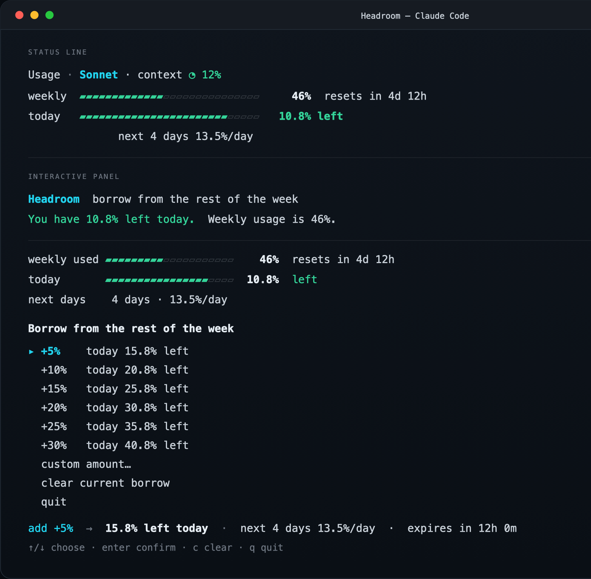

# Headroom

[](https://github.com/mishoshup/headroom/actions/workflows/ci.yml)

Weekly usage pacing for Claude Code, maintained by
[Mishoshup](https://github.com/mishoshup).

Headroom enforces a daily share of the weekly subscription allowance and
reports how much of today's allowance remains. It is a single native Rust
binary with no runtime dependencies.



## Overview

Claude Code exposes the weekly rate-limit percentage and its reset time to the
status-line command. Headroom divides what is left of the week across the days
that remain:

```
remaining = 100 - used
days_left = days left including today
today's allowance = remaining / days_left
```

The allowance is fixed for the day. At the next day it is recomputed from
actual usage, so an unused share carries into the remaining days.

Example: a new week, use 2% on day 1.

```
day 1: 100 / 7 = 14.29%
day 2: 98 / 6 = 16.33%
```

The plugin provides two surfaces:

1. A concise status line reporting weekly usage, today's remaining allowance,
   and the per-day allowance for the rest of the week.
2. An interactive panel for borrowing part of the rest of the week into today.

## Status line

```
Usage · Sonnet · context ◔ 12%
weekly  ▰▰▰▰▰▰▰▰▰▰▰▰▰▱▱▱▱▱▱▱▱▱▱▱▱▱▱▱  46%  resets in 4d 12h
today   ▰▰▰▰▰▰▰▰▰▰▰▰▰▰▰▰▰▰▰▰▰▰▰▱▱▱▱▱  10.8% left
        next 4 days 13.5%/day
```

- The header and bar rows share an eight-column label gutter.
- `today` reports only how much is left today; there is no “extra of weekly”
  suffix.
- The line below reports `(100 - used) / days after today`, updated live. As
  usage grows today, the future per-day figure falls.
- With a borrow:

```
today   ▰▰▰▰▰▰▰▰▰▰▰▰▰▰▰▰▰▱▱▱▱▱▱▱▱▱▱▱  30.8% left
        next 4 days 13.5%/day · +20% borrowed
```

## Interactive panel

Run `~/.claude/headroom/headroom` without arguments, or
`~/.claude/headroom/headroom borrow`, in a terminal.

```
Headroom  borrow from the rest of the week
You have 10.8% left today.  Weekly usage is 46%.
────────────────────────────────────────────────
weekly used ▰▰▰▰▰▰▰▰▰▰▰▰▰▱▱▱▱▱▱▱    46%  resets in 4d 12h
today       ▰▰▰▰▰▰▰▰▰▰▰▰▰▰▰▰▰▰▰▰  10.8%  left
next days    4 days · 13.5%/day

Borrow from the rest of the week
▸ +5%     today 15.8% left
  +10%    today 20.8% left
  +15%    today 25.8% left
  +20%    today 30.8% left
  +25%    today 35.8% left
  +30%    today 40.8% left
  custom amount…
  clear current borrow
  quit

add +5%  →  15.8% left today  ·  4 days · 13.5%/day  ·  expires in 12h 0m

↑/↓ choose · enter confirm · c clear · q quit
```

Behaviour:

- `enter` applies the selected borrow; `c` clears it; `q` exits.
- Every option previews the resulting left-today amount.
- Borrow is for today. There is no week-scope toggle.
- If the weekly budget is exhausted, nothing can be borrowed.

## Borrowing

A borrow adds percentage points of the weekly limit to today's allowance. It
does not create quota: it moves part of the rest of the week into today.

```bash
~/.claude/headroom/headroom borrow 20
```

```
headroom: added +20% for today.
today's allowance: 56.8% -> 76.8%.
30.8% left today.
next 4 days 13.5%/day.
expires in 12h 0m.
```

- `borrow 20` — add 20% to today's allowance, capped by the amount left for
  the rest of the week.
- `borrow 10 --note "off Friday and Saturday"` — attach a note.
- `borrow status` — display the active borrow and today’s position.
- `borrow clear` — remove it.

The credit is stored in `~/.claude/headroom/credit.json`, keyed to the weekly
reset and day. The borrow adds to the fixed day cap; tomorrow recomputes from
actual usage, so anything not used today returns to the rest of the week.
Inside Claude Code, `/headroom:borrow 20` works even when today's allowance is
used: the hook exempts the `headroom borrow` command from the guard. On Windows,
use `%USERPROFILE%\.claude\headroom\headroom.exe borrow 20`.

## Enforcement

- When today's allowance is used, `PreToolUse` denies tools and
  `UserPromptSubmit` blocks prompts until the next day.
- When the weekly budget is exhausted, both stay blocked until the weekly
  reset.
- `headroom borrow`, `borrow clear`, `setup`, and `doctor` are exempt from the
  guard through a strict command allowlist.
- The status line shows `0% left` in red.
- A separate 5-hour ceiling is enforced at 98% by default.

## Installation

Requirements:

- Claude Code 2.1 or later with a Pro, Max, or Ultra subscription
- `curl` and `tar` for the prebuilt installation on macOS/Linux
- PowerShell 5.1+ for the prebuilt installation on Windows
- Rust 1.74 or later only when installing from source with `--build`
- macOS, Linux, WSL, or Windows 10/11

```bash
claude plugin marketplace add mishoshup/headroom
claude plugin install headroom@mishoshup
```

Then run `/headroom:setup` inside Claude Code. The setup skill downloads the
matching prebuilt binary for the platform (PowerShell on Windows, Bash
elsewhere); no Rust toolchain is required. For a local checkout:

```bash
claude plugin marketplace add ~/Developer/headroom
claude plugin install headroom@mishoshup
bash ~/Developer/headroom/scripts/install.sh --build
```

The installer places the binary under `~/.claude/headroom/`, copies the hook
binary into the plugin directory, backs up `settings.json`, and calls the
binary's own `setup` command to wire the status line. Claude Code must be
restarted after installation so that the hooks are loaded.

If a different status line is already configured, the installer leaves it
untouched. Pass `--force` to replace it.

The binary is installed at `~/.claude/headroom/headroom` on macOS/Linux/WSL and `%USERPROFILE%\.claude\headroom\headroom.exe` on Windows; it is **not**
added to `PATH`. The hooks invoke it by absolute path, and all borrow commands
in this document use that absolute path.

## CLI-only installation

The same release assets can be installed by a general binary installer:

```bash
mise use -g github:mishoshup/headroom
# or, with Rust installed:
cargo binstall --git https://github.com/mishoshup/headroom
headroom setup
```

This installs the CLI and can wire the status line, but Claude Code's plugin
hooks still require the plugin setup above; use `/headroom:setup` for the full
installation.

## Configuration

Environment variables are read by the binary at invocation. They must be set
in the environment that launches Claude Code.

| Variable | Default | Purpose |
|---|---|---|
| `HEADROOM_PACING` | `on` | Set to `off` to disable the weekly pace guard. |
| `HEADROOM_BLOCK_PROMPTS` | `1` | Set to `0` to block tools only. |
| `HEADROOM_FIVE_HOUR_LIMIT` | `98` | Five-hour ceiling, in percent. |
| `HEADROOM_FIVE_HOUR_MODE` | `block` | `wait` sleeps until the five-hour reset instead of denying. |
| `HEADROOM_STALE_AFTER` | `900` | Maximum snapshot age, in seconds. |
| `HEADROOM_WEEK_DAYS` | `7` | Window length, in days. |
| `HEADROOM_COLOR` | automatic | `off`, `16`, `256`, or `truecolor`. `NO_COLOR` also disables colour. |
| `HEADROOM_ASCII` | `0` | Set to `1` for ASCII bars and glyphs. |
| `HEADROOM_BOTTOM_MARGIN` | `1` | Blank rows between the status line and the built-in footer (0–3). |
| `HEADROOM_STATE` | `~/.claude/headroom/state` | Snapshot path. |
| `HEADROOM_CREDIT` | `~/.claude/headroom/credit.json` | Borrow-credit path. |

## Failure behaviour

- The guard fails open when the snapshot is absent, malformed, or older than
  `HEADROOM_STALE_AFTER`. A broken meter must not prevent work.
- The status line is the source of the rate-limit snapshot; if the status
  line is not configured, enforcement is inactive.
- State and credit writes are atomic (temporary file followed by rename).
- Day boundaries are anchored to the weekly reset instant, not local
  midnight.

## Development

```
src/
  main.rs        subcommand dispatch
  config.rs      environment configuration and colour detection
  state.rs       usage snapshot with atomic persistence
  pace.rs        allowance arithmetic
  credit.rs      borrow persistence and CLI
  render.rs      status-line rendering
  style.rs       truecolor, 256-colour, 16-colour, and plain output
  hook.rs        PreToolUse and UserPromptSubmit enforcement
  statusline.rs  status-line input handling
  ui.rs          interactive borrow panel
hooks/hooks.json command registrations
scripts/install.sh build, install, settings backup, status-line wiring
tests/cli.rs     end-to-end behaviour tests
```

The runtime contract is documented in [docs/CONTRACT.md](docs/CONTRACT.md).
Architecture decisions are recorded in
[docs/adr](docs/adr/0001-rust-binary-flat-state.md).

Quality gates:

```bash
cargo fmt --check
cargo clippy --all-targets -- -D warnings
cargo test --release
```

The crate forbids `unsafe` and denies `todo!`, `unimplemented!`, and `dbg!`.
The minimum supported Rust version is 1.74. CI runs formatting, linting,
tests, and a release build on every push.

## Diagnostics

```bash
~/.claude/headroom/headroom doctor
```

Prints the binary path, snapshot path and age, available windows, active
credit, the configured statusline command, and `HEADROOM_*` overrides.

## Uninstall

```bash
claude plugin uninstall headroom@mishoshup
claude plugin marketplace remove mishoshup
rm -rf ~/.claude/headroom
```

Remove the `statusLine` key from `~/.claude/settings.json` if another status
line is not configured in its place.

## Licence

MIT © 2026 Mishoshup
